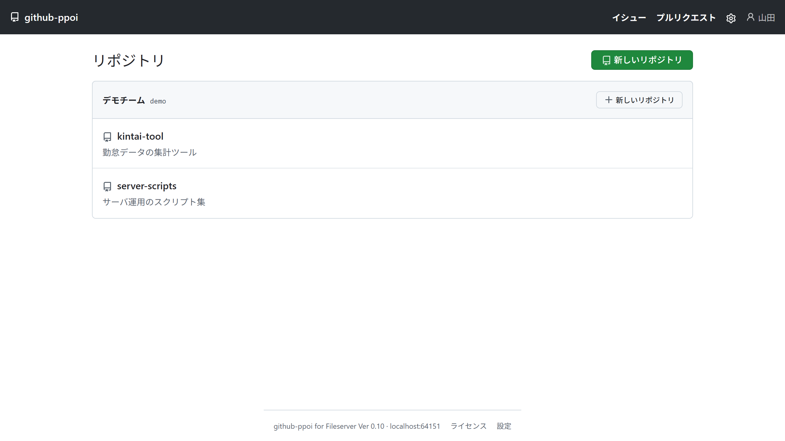
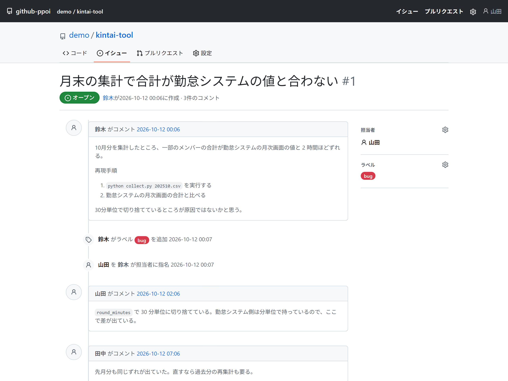
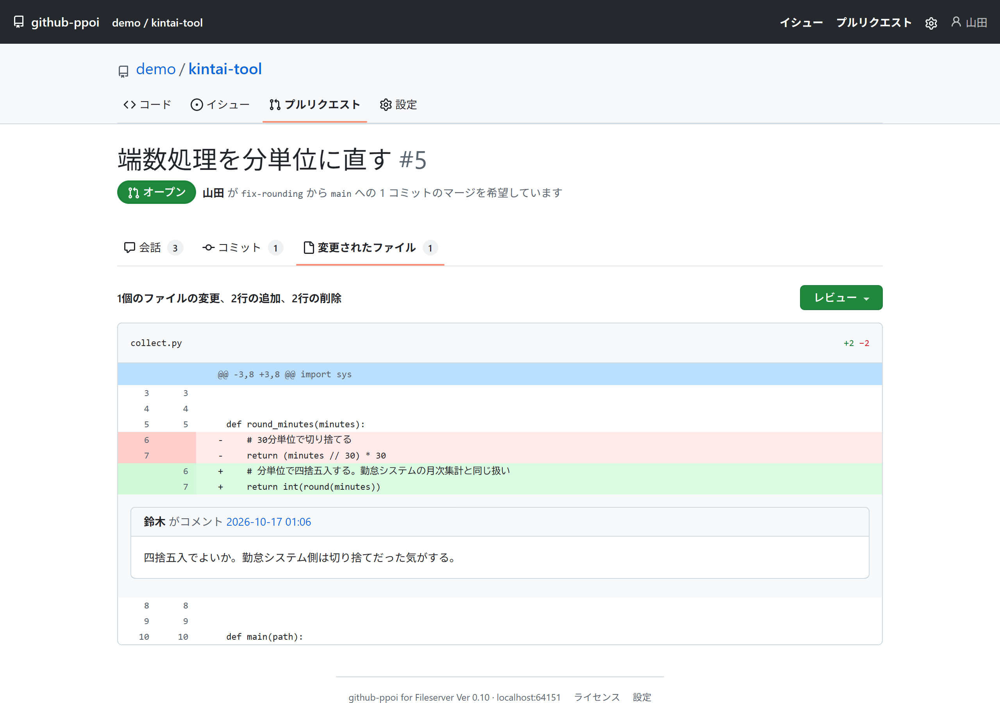
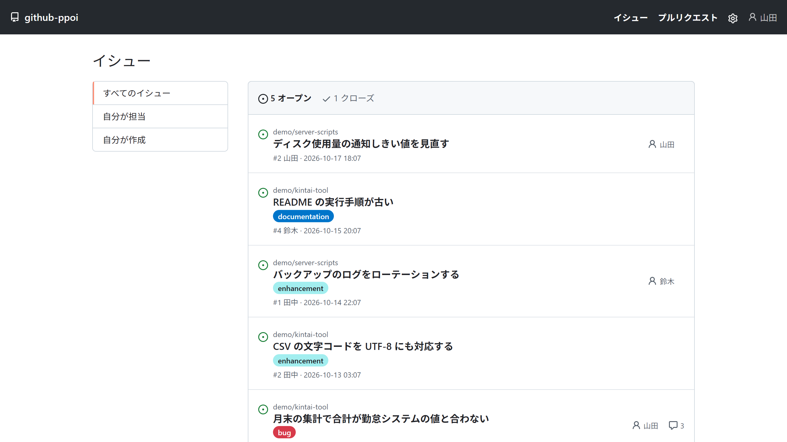

<p align="center">
  
</p>

<h1 align="center">github-ppoi for Fileserver</h1>

<p align="center"><strong>ファイルサーバさえあれば、IssueもコードレビューもPRもGithubっぽいWebUIからできる</strong></p>

<p align="center">A GitHub-like issue tracker and code review tool that runs on each client PC and keeps all of its data on a plain SMB file server. No server, no database.</p>

<p align="center">
  <a href="LICENSE"></a>
  
  <a href="https://github.com/rynex4581/github-ppoi-for-fileserver/releases/latest"></a>
  <a href="https://github.com/rynex4581/github-ppoi-for-fileserver/stargazers"></a>
</p>

Githubっぽいのをファイルサーバでやるやつ。

## インストール

[Releases](https://github.com/rynex4581/github-ppoi-for-fileserver/releases/latest) から `github-ppoi.exe` を落として起動する。Git for Windows が入っていればそれだけでよい。

<p align="center">
  
</p>

> 各自の端末で動き、データはすべてファイルサーバの共有フォルダに置く、GitHub 風の Issue 管理とコードレビューのツール。

## 背景

筆者の職場の端末は外部からの接続を受け付けないWindowsの仮想デスクトップで、端末上でサーバを動かしても他の端末からは使えない。使える共有の場所はファイルサーバ（SMB）だけである。<br>
仮想サーバは申請しているが~~予算の関係で~~割り当てられず、GitHubは職場ではDownloadはOKだが内製ツールのリポジトリ置き場としては~~グレーな扱いで~~使えない。

一方で、職場では業務自動化ツールをOpenAI Codexで内製しており、Issueによる管理とコードレビューの仕組みが要る。~~それなのにGitのリポジトリ置き場すらくれないとか意味わからない。~~
Gitea程度の使い勝手で、ブラウザから直感的に使えることが条件であった。

サーバ不要でIssueを扱えるツールとしてBacklog.mdを検証したが、pullとpushを利用者が意識する必要があり、職場のメンバーには使わせられないと判断した。次にGiteaを各端末で起動し、SQLiteのデータベースとリポジトリを共有フォルダに置く形を検証した。動作はしたが、SQLiteはネットワーク上のデータベースファイルを複数のマシンから使うことを公式に推奨しておらず、Giteaも複数インスタンスではデータベースサーバとRedisを求めている。公式の想定から外れる形で職場に入れることはできないと判断した。

そこで、各自の端末で動き、ファイルサーバをデータ置き場とし、Gitea API互換のAPIを持つツールを自作することにした。Gitea互換にしたのは、CodexにGiteaのAPIを使わせる形でIssueの読み書きをさせるためである。

本ツールの設計と実装は、Claude（Fable 5.1）とClaude Codeで行った。

## Features

- 🗂️ **サーバもデータベースも使わない。** データの正本はすべて共有フォルダ（データルート）にあり、端末側の exe、設定、キャッシュは消えてよい
- 📁 **複数のデータルートを1つの画面で扱える。** データルート1つが owner 1つに対応し、URL は `/<owner>/<リポジトリ名>/`
- 🐞 **Issue。** 状態・ラベル・担当者での絞り込み、コメント、クローズと再オープン、ラベルと担当者の変更
- 🔀 **Pull Request。** ブランチを選んで作成、Conversation／Commits／Files changed、承認・変更要請・コメントのレビュー、差分への行コメント、`--no-ff` のマージと Revert、コンフリクトと force push の表示、承認必須の設定
- 📄 **Code。** ファイルツリー、Markdown と画像の表示、ブランチ切替、コミット履歴と差分、clone コマンドの表示
- 🏷️ **ラベルの管理**と 📎 **添付ファイル**（本文の入力欄に Ctrl+V で画像を貼り付け）
- 🔍 **横断ページ。** 全 owner の Issue と Pull Request を1つの一覧で見る（すべて／自分に割り当て／自分が作成）
- 🤖 **Gitea API v1 互換の API。** tea（Gitea 公式 CLI）や Codex からそのまま使える
- ⚡ **イベントのローカルキャッシュ。** 2回目以降の表示では新しいファイルだけを共有フォルダから読む
- 🌐 **日本語と英語。** 画面の文言は Gitea の言語ファイルをそのまま使う
- 🔔 **運用まわり。** 待ち受けポートの自動選択、二重起動の検知、データルートの `bin\` に置いた新しい exe の通知

##  Getting started

### exe を置く

`github-ppoi.exe` は端末のどこに置いてもよい。配布用にはデータルートの `bin\` に置くと、古いバージョンを使っている端末の画面に「新しいバージョンがある」と出る。Git for Windows が入っていること（`git` がコマンドラインから呼べること）が前提になる。

### 初回の起動

起動するとブラウザに設定画面が開く。データルートにするフォルダ（共有フォルダのパス）と owner 名を入れて登録する。

- owner 名は URL に使うので半角英数（`.` `_` `-` 可）。表示名は任意で、日本語でよい
- `config.json` の無いフォルダを指定すると、そのフォルダをデータルートとして初期化する。既にデータルートになっているフォルダなら登録だけを行う
- 設定は `%LOCALAPPDATA%\github-ppoi\config.json` に保存される

### 2つ目以降のデータルート

画面右上の歯車から「自分の設定」を開き、データルートを追加する。1つのデータルートが owner 1つに対応し、同じ owner 名のデータルートは2つ登録できない。トップ画面には owner ごとにリポジトリが並ぶ。

> [!TIP]
> 待ち受けポートは 9418 から 9427 の範囲で空いているものを使う。上がったポートは画面のフッターと `%LOCALAPPDATA%\github-ppoi\port.txt` に出る。
> `config.json` に `"port"` を書けばそのポートだけを使い、使えなければエラーで止まる。
> 既に起動しているときにもう一度起動すると、ブラウザだけ開いて新しい方は終了する。`--no-browser` を付けると起動時にブラウザを開かない。

### ソースからビルドする

Go 1.27 以上と Git for Windows が要る。

```powershell
go install github.com/josephspurrier/goversioninfo/cmd/goversioninfo@v1.7.0
go generate ./cmd/github-ppoi
go build -o github-ppoi.exe ./cmd/github-ppoi
.\github-ppoi.exe
```

`go generate` は exe のプロパティに出すバージョン（VERSIONINFO）のリソースを作る。goversioninfo（MIT）はビルドのときだけ使い、exe には入らない。省くとビルドはできるが、exe にバージョンが入らず、更新通知の比較もできない。

## Codex／AI エージェントと使う

`localhost:<ポート>/api/v1/` に Gitea API v1 と同じ形のエンドポイントがあるので、Gitea に対応したツールやエージェントはそのまま使える。ポートは `%LOCALAPPDATA%\github-ppoi\port.txt` に書いてある。トークンは空でなければ何でも通る（`Authorization: token x`）。`/api/v1/version` だけは認証無し。

持っているもの

- user、users/{login}、user/orgs、orgs/{org}、user/repos、repos/search、orgs/{org}/repos
- repos/{owner}/{repo}：本体、branches、commits、git/commits/{sha}（`.diff` 付きで差分）、contents、raw、compare/{base}...{head}
- issues：一覧（state、type、labels、q）、作成、取得、PATCH（title、state、assignees、labels）、comments、labels、assets
- labels：一覧、作成、取得、PATCH、削除
- pulls：一覧、作成、取得、PATCH、`.diff`、commits、files、merge（`Do` は merge のみ）、reviews（APPROVED／REQUEST_CHANGES／COMMENT と行コメント）
- tea（Gitea 公式 CLI）の v0.16 で、ログイン、リポジトリ一覧、Issue の一覧・作成・表示・クローズ、コメント、ラベル、ブランチ、PR の一覧・作成・マージが通ることを確認した

予定（未実装）

- Issue 本文の書き換え（PATCH の `body`）
- マイルストーン、Wiki、リリース、通知など、上に無い Gitea API の範囲

Codex に使わせるときは、対象のリポジトリの AGENTS.md に次のように書く。

> Issue と Pull Request は localhost の Gitea 互換 API で扱う。
> ポートは `%LOCALAPPDATA%\github-ppoi\port.txt` に書いてある。
> URL は `http://localhost:<ポート>/api/v1/repos/<owner>/<リポジトリ名>/...` で、
> Authorization ヘッダは `token dummy` のように空でない値を付ける。

##  Web 画面

Issue の詳細。本文とコメントは Markdown で書け、右側で担当者とラベルを変える。

<p align="center">
  
</p>

Pull Request の Files changed。差分の行にコメントを付けられる。

<p align="center">
  
</p>

横断ページ。全 owner、全リポジトリの Issue を1つの一覧で見る。

<p align="center">
  
</p>

## 設計の要点

- Issue、コメント、状態変更はすべて「イベント1件につき1ファイル」の追記で保存し、既存ファイルの上書きは行わない。現在の状態はイベントを時系列に適用して組み立てる
- Issue番号は、番号のフォルダを「既に存在すれば失敗する」方式で作成し、作成できた側がその番号を取る。SMB上の排他をこの1点に絞る
- イベントのファイル名は「UTC時刻（ミリ秒）_端末名_端末内連番」とし、端末間で重複しないようにする
- ファイルは一時名で書いてからrenameし、書きかけが他の端末から見えないようにする
- 画面はGitHubの構成と導線を~~パク~~リスペクトする！ CSSはPrimer、アイコンはOcticonsを使い、すべてexeに埋め込む。外部への参照は持たない
- 画面の文言はGiteaの言語ファイルをそのまま使う。既定は日本語で、英語に切り替えられる
- gitは各端末のGit for Windowsを呼ぶ。exeには同梱しない

## データルートの構成

```
<データルート>\
  config.json                  このデータルートの設定（owner 名、owner の表示名、既定のブランチ名など）
  repos\
    <リポジトリ名>.git\        ベアリポジトリ
  meta\
    users\<ログオン名>.json    表示名
    <リポジトリ名>\
      repo.json                説明、既定のブランチ名、承認必須、force push禁止
      labels.json              ラベル
      issues\
        000012\
          events\              イベント（1件1ファイル）
          attachments\         添付ファイル
```

## 設定

端末側 `%LOCALAPPDATA%\github-ppoi\config.json`

| 項目 | 内容 | 既定 |
| --- | --- | --- |
| `data_roots` | データルートのパスの一覧 | 無し（設定画面で登録する） |
| `port` | 待ち受けポート。書くとそのポートだけを使う | 9418〜9427 から空きを探す |
| `lang` | 画面の言語。`ja-JP` または `en-US` | `ja-JP` |

データルート直下の `config.json`

| 項目 | 内容 | 既定 |
| --- | --- | --- |
| `owner` | owner 名。URL に使う半角英数。データルートを作るときに決める | 無し（必須） |
| `owner_name` | owner の表示名。日本語可 | 空（owner 名を表示） |
| `default_branch` | 新規リポジトリの既定ブランチ名 | `main` |
| `attachment_max_bytes` | 添付ファイルのサイズ上限 | 10485760（10 MB） |

どちらも設定画面から書き換えられる。端末側のファイルは消しても、exe を起動してデータルートを登録し直せば元に戻る。

## Troubleshooting

**起動時に「ポート 9418〜9427 がすべて使用中」と出る**

他のプログラムがその範囲を使っている。`%LOCALAPPDATA%\github-ppoi\config.json` に `"port": 9500` のように空いているポートを書いて起動し直す。本ツールがもう上がっているだけなら、新しい方はブラウザを開いて終了するので、この表示にはならない。

**git が「dubious ownership」「safe.directory」の警告を出す**

共有フォルダ上のベアリポジトリは所有者が自分と違うため、Git for Windows が安全のために弾く。本ツールが git を呼ぶときは `safe.directory=*` を付けているので画面には出ないが、自分で clone や push をするときに出る。次を一度実行する。

```powershell
git config --global --add safe.directory "*"
```

`*` の代わりに特定のパスだけを許可してもよい。

## 現在の状態

Ver 0.10。開発中であり、職場で使える状態ではない。

未実装

- SMB 上の同時更新の検証。本体と同じ採番と書き込みを2台から同時に回す `smbtest.exe` を Releases に置いている。2台で `.\smbtest.exe -root <共有フォルダ>\smbtest -n 2000` を同時に実行し、終わってから `-check` で番号の重複と書きかけの読み込みが無いかを確かめる
- Gitea API のうち、上の「予定（未実装）」に挙げたもの

リリースは GitHub Actions で行う。`v0.10` のようにタグを打つと、Windows 用の exe をビルドして Releases に置く。タグは `internal/version` の Number と一致していないと失敗する。README の画像は `go run ./tools/screenshot` で撮り直せる（端末の Chrome、Iron、Edge のいずれかを使う）。

## ライセンス

MIT License。同梱しているOSS（Primer CSS、Octicons、Giteaの言語ファイル）のライセンスは [third_party/](third_party/) を参照。
